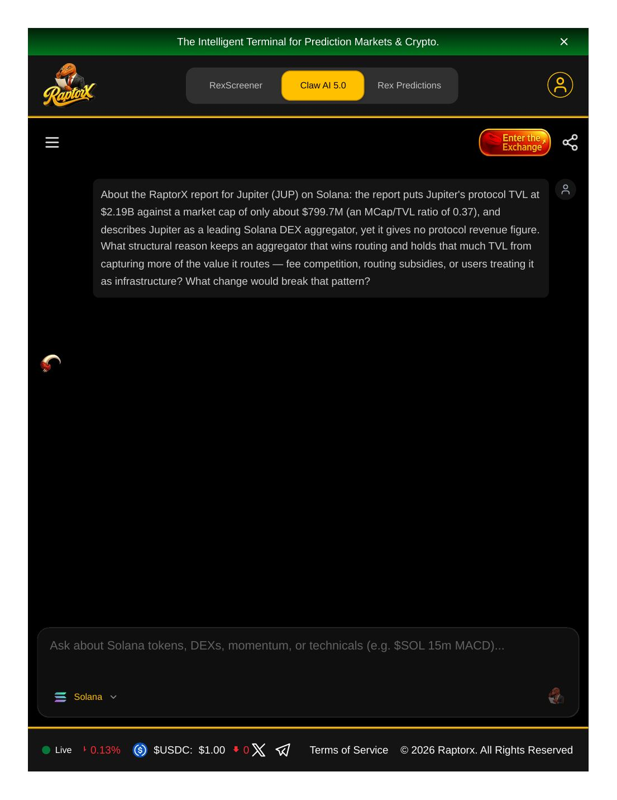
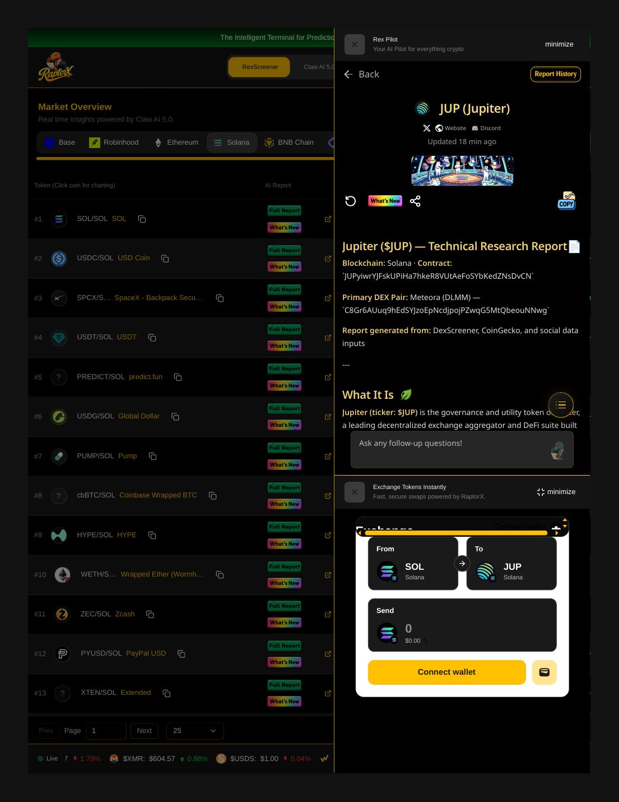
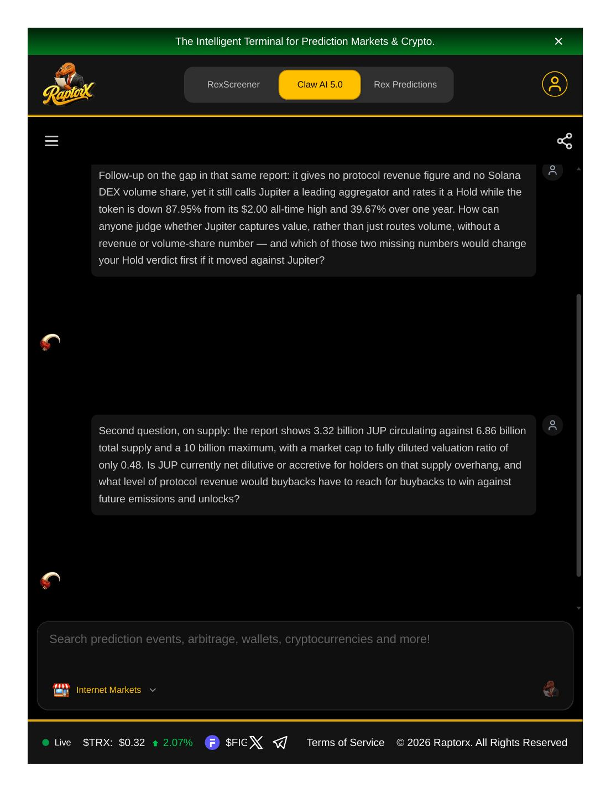

# RaptorX Research Challenge — Entry Evidence

Entry by Dammy Okunlola for the RaptorX Research Challenge on Superteam Earn.
All research was done live on [RaptorX](https://www.raptorx.trade) on November 2, 2026.

## What was done

1. Generated the JUP (Jupiter) Technical Research Report on RaptorX.
   Key figures from the report: TVL $2.19B, market cap ~$799.7M, MCap/TVL ratio 0.37,
   3.32B JUP circulating against 6.86B total and 10B maximum supply.
2. Asked REX / Claw AI 5.0 three questions built from the report's own figures,
   centred on the volume-versus-revenue-capture contradiction: Jupiter routes a
   leading share of Solana DEX volume, yet the report contains no protocol revenue
   figure and no volume share, while rating the token a Hold at 87.95% below its
   $2.00 all-time high. The follow-ups press on which of the two missing numbers
   would change the Hold verdict first, and on whether JUP is net dilutive or
   accretive for holders given the supply overhang (MCap/FDV 0.48) and what level
   of protocol revenue buybacks would need to win against future emissions.

## Honest note on the AI answers

REX AI returned no answers during the session. The chat endpoint was failing
with server errors for multiple entrants at the time (visible in the listing
comments), across four separate chats over more than an hour. The questions
themselves, which are what this challenge judges, are captured in full in the
screenshots below, inside the live RaptorX thread:
https://www.raptorx.trade/claw-v5/cmvzwyesh000rjo08lz5ih7ze (sign-in required,
which is why this public evidence page exists).

## Screenshots

First chat with Claw AI 5.0:

The JUP report page on RaptorX:

The three-question thread:

